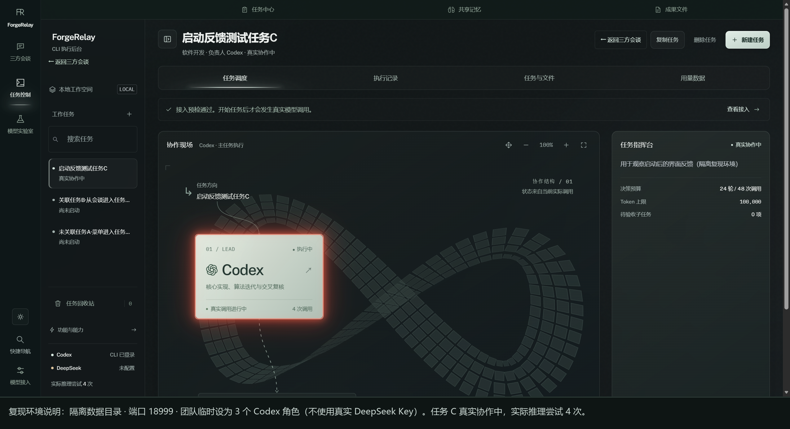
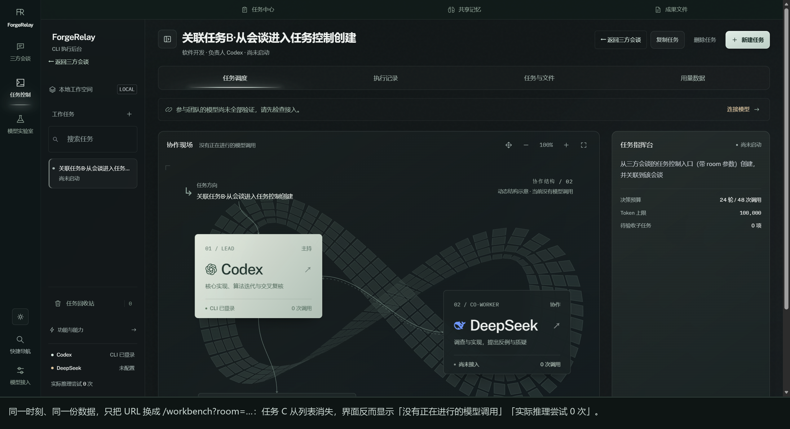
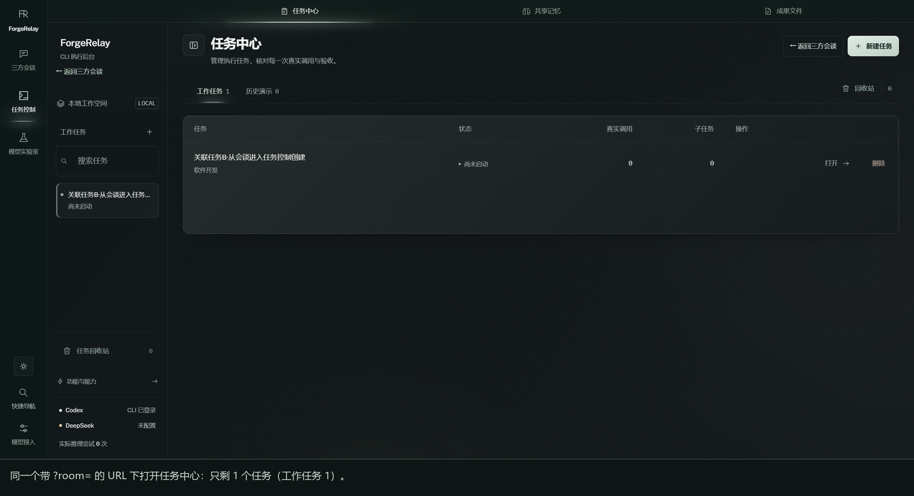
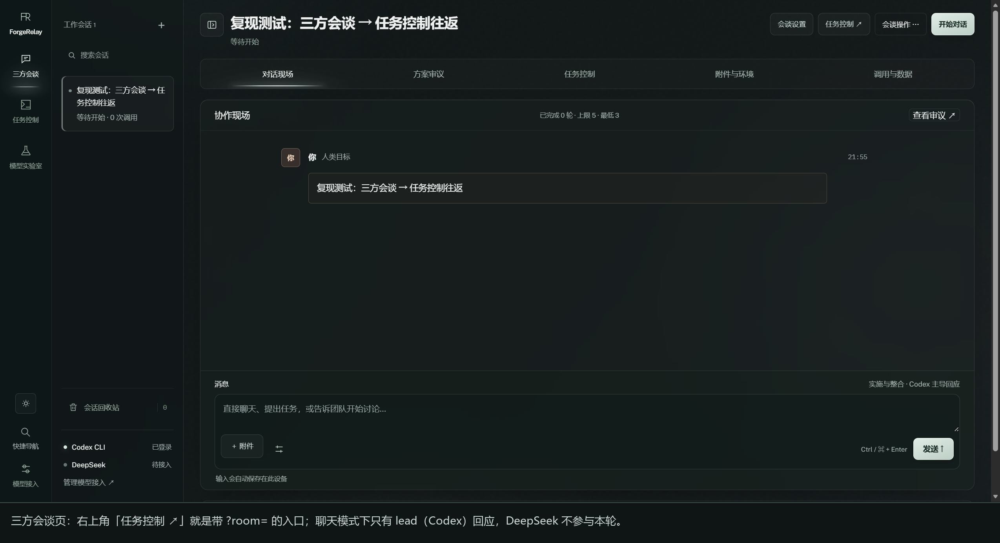
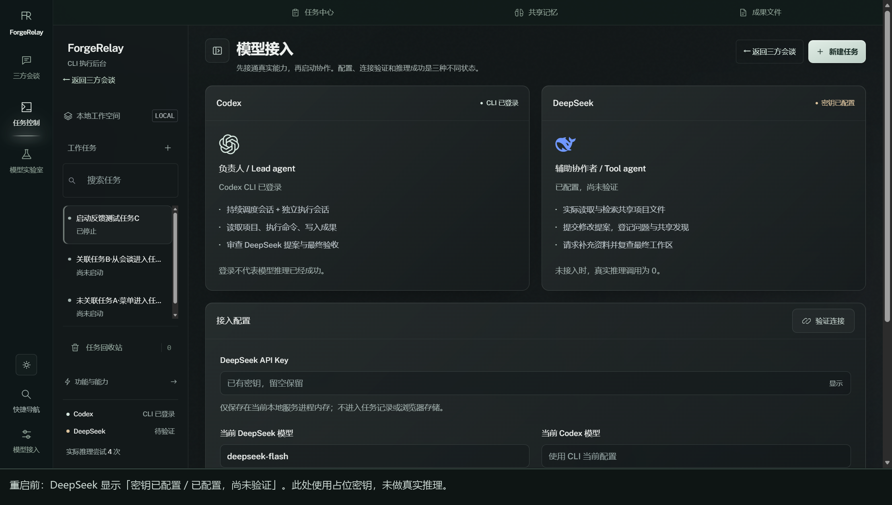

# ForgeRelay 0.6.1 · 前端问题报告

> 提交对象：ForgeRelay 作者
> 被测版本：`ForgeRelay-0.6.1-Windows-x64.exe`（便携版，engine `/api/health` 返回 `version: 0.6.1`）
> 运行环境：Windows 11（NT 10.0.26200）· Codex CLI `0.164.0-alpha.11.1`（ChatGPT 账号已登录）· Clash for Windows 系统代理 `127.0.0.1:7890`
> 复现方式：解包 `resources/app.asar` 与 `resources/engine/*.mjs` 源码审查；用同一份 engine 代码在独立数据目录（端口 `18999`）启动真实前端，并用浏览器自动化逐个点击验证。截图见 `evidence/`。
> 说明：本文件的每一条都标注了「已复现 / 仅源码确认 / 需你补充信息」，没有把握的不写成 bug。

---

## 0. 摘要

| 编号 | 严重度 | 问题 | 状态 |
| --- | --- | --- | --- |
| F-1 | 🔴 严重 | 「任务控制」左栏和任务中心被 URL 里的 `?room=` 静默过滤，任务在会话往返后"消失" | 已复现 |
| F-2 | 🔴 严重 | 正在运行的任务在会谈视图里完全不可见，界面反而显示"没有正在进行的模型调用 / 0 次推理尝试" | 已复现 |
| F-3 | 🟠 中 | 启动任务后长时间没有任何过程反馈（无耗时、无重试、无"正在等待模型返回"） | 已复现 |
| F-4 | 🟠 中 | 聊天模式只有 lead 发言，DeepSeek 不参与，界面没有任何说明（容易被理解成"DeepSeek 被拒绝输出"） | 已复现（源码 + 截图） |
| F-5 | 🟠 中 | DeepSeek 密钥重启即失效；提示只在页面小字里，桌面版每次启动都要重填 | 已复现（设计如此，但 UX 是问题） |
| F-6 | 🟡 轻 | 视图作用域不一致（`?room=` / `?task=` / 无参数三种语义）、任务计数缺失、窄窗口列表易误判为空 | 已确认 |

复现用的两个 URL（同一台机器、同一份数据、只差一个参数）：

```
A. 菜单/快捷键进入：http://127.0.0.1:18999/workbench#control
B. 会谈页「任务控制 ↗」：http://127.0.0.1:18999/workbench?room=de9ad43c-39df-4266-be76-6ecd9a3eab81#control
```

A 显示 3 个任务（其中 1 个"真实协作中"），B 只显示 1 个任务，另外 2 个（含正在运行的那个）整体消失。

> **关于截图左下角的「DeepSeek 未配置」**
>
> 这几张任务列表截图来自**隔离复现环境**，为了不消耗你的 DeepSeek 额度、也不使用你的密钥，把该环境的团队临时设成 3 个 Codex 角色，所以左下角显示「DeepSeek 未配置」、「协作结构 / 01」。这是**复现环境的配置**，不是产品状态，也不影响 F-1/F-2 的结论——任务列表过滤只取决于 URL 里的 `?room=` 和 `task.sourceDiscussion` 字段。
>
> DeepSeek 相关证据另外用真实 Key 跑了一组（`evidence/08-模型接入-API已验证.png`、`09`、`10`），见后端报告 B-3/B-4。两组都跑在同一份 engine 代码上，正式数据目录没有被修改。

| A：`/workbench#control` | B：`/workbench?room=…` |
| --- | --- |
|  |  |

---

## F-1 🔴 任务列表被 `?room=` 静默过滤，任务"消失"

### 现象

1. 从菜单「工作空间 → 任务控制」（`CmdOrCtrl+2`，`main.cjs:119`）进入任务控制，URL 是 `/workbench#control`，左栏正常列出所有任务。
2. 点「← 返回三方会谈」，再点会谈页右上角「任务控制 ↗」（`discussion.js:20` / `human-loop-ui.js:5`），URL 变成 `/workbench?room=<会谈ID>#control`。
3. 原来那个任务不见了。左栏、任务中心（「工作任务」）、共享记忆、成果文件全部只剩"属于这个会谈"的任务。

### 复现步骤（已实测）

```text
1) /workbench#control            → 左栏：启动反馈测试任务C（真实协作中）、关联任务B（尚未启动）、未关联任务A（尚未启动）
2) 进入 /workbench?room=<room>   → 左栏：只剩「关联任务B」
   任务中心计数：工作任务 1
   协作现场："没有正在进行的模型调用"，左下"实际推理尝试 0 次"
3) 回到 /workbench#control       → 3 个任务又都回来了
```

### 证据

- 截图：`evidence/01-…png`（3 个任务）对比 `evidence/02-…png`（只剩 1 个）；任务中心同样是 `工作任务 1` + 单行表格：

  
- 前端过滤代码：
  - `public/app.js:34` `const routeParams=new URLSearchParams(location.search), sourceRoomId=routeParams.get('room');`
  - `public/app.js:37` `const current = () => state.tasks.find(t => … && (!sourceRoomId||t.sourceDiscussion?.id===sourceRoomId));`
  - `public/app.js:38` `const liveTasks = () => state.tasks.filter(t => !t.legacy&&!t.deletedAt&&(!sourceRoomId||t.sourceDiscussion?.id===sourceRoomId));`
  - `public/app.js:39` 回收站同样过滤；`public/app.js:69`（左栏）、`app.js:147-150`（任务中心）、`app.js:153`（共享记忆）、`app.js:157`（成果文件）全部基于 `liveTasks()`。
- 后端返回的是**全量**任务：`server.mjs:87` `/api/state` → `tasks: publicTasks(workbench.tasks)`，过滤只发生在前端。
- 用户数据佐证：`%APPDATA%\ForgeRelay\data\tasks.json` 共 5 个任务，其中 **3 个没有 `sourceDiscussion`**（从菜单进入任务控制后创建的），只有 2 个关联到会话 `a84e378e…`。也就是说，只要在会谈视图进入过任务控制，这 3 个任务就会全部"消失"。

### 根因

任务与会话的归属关系存在数据里（`task.sourceDiscussion.id`），但**只有前端按 URL 参数过滤，而且不告诉用户当前是"按会话过滤"状态**。同一个"任务控制"入口有两个不同作用域：

- `runtime-ui.js:25` `workbench:'/workbench'+(room?'?room='+room:'')+'#control'`（全局导航：带当前 room 时才加参数）
- `discussion.js:20` `executionUrl=r=>'/workbench'+(r?'?room='+r.id:'')+'#control'`
- `main.cjs:119-120` 菜单：「任务控制」= `/workbench#control`，「模型接入」= `/workbench#settings`（不带 room）

用户完全无法从界面看出"我现在看的是全部任务，还是只有这个会谈的任务"。

### 修复建议

1. **显式化作用域**（最小改动）：在 `pageHead`/左栏顶部加一行
   「当前视图：仅显示「<会谈标题>」的任务 · [显示全部任务]」，点一下把 `?room=` 去掉。
2. **默认不过滤**：`liveTasks()` 只在用户主动点"只看本会谈"时才过滤；至少要让 `selected` 指向的任务、以及所有 `running/paused/queued` 任务永远可见（参考实现）：

   ```js
   const liveTasks = () => state.tasks.filter(t => !t.legacy && !t.deletedAt &&
     (!sourceRoomId || t.sourceDiscussion?.id === sourceRoomId || t.id === selected ||
      ['running','pausing','paused','waiting_user','queued'].includes(t.status)));
   ```

3. **服务端给作用域**：`/api/state` 里每个 task 已带 `sourceDiscussion.id`，建议再加 `rooms` 列表与计数，前端不要再"凭 URL 参数隐式过滤"。
4. **左栏显示计数**：`工作任务 <b>${liveTasks().length}</b> / 全部 ${state.tasks.filter(t=>!t.deletedAt).length}`，用户一眼能看出被过滤了。

### 验收标准

- 从会谈进入任务控制后，正在运行/已创建但未关联的任务仍能在列表里看到，或被明确标注"属于其他会话/未关联"。
- 任一视图下，任务数量变化必须能从 UI 上解释（计数或提示），不能静默变少。

---

## F-2 🔴 运行中的任务在会谈视图不可见，界面却显示"没有正在进行的模型调用"

### 现象

任务 C 正在真实调用 Codex（后台已 4 次调用、状态 `running`），打开 `/workbench?room=…` 后：

- 左栏没有任务 C；
- 「任务指挥台」显示另一个任务的「尚未启动」；
- 「协作现场」副标题："没有正在进行的模型调用"；
- 左下统计："实际推理尝试 0 次"。

这与引擎真实状态直接矛盾。用户在别的视图看到"真实协作中"，切到这里却像什么都没发生，也无法暂停/停止这个隐藏的任务——这正好对应你说的「任务会消失，但仍显示正在进行」。

### 证据

- 引擎真实状态（同一时刻）：

  ```json
  { "status": "running", "step": 3, "calls": 3, "activity": { "actor": "Codex" } }
  ```

  同期截图 `evidence/02-…png` 显示的是"没有正在进行的模型调用"。
- 对照截图 `evidence/01-…png`：同一时刻在 `/workbench#control` 里，任务 C 明确显示「真实协作中」、`4 次调用`。

### 根因

同 F-1：视图过滤 + 没有任何"全局运行中任务"的提示组件。`ambientControl()`（`runtime-ui.js:34`）只是"光效开关"，不含运行状态；`network()` 的忙碌态只来自 `current()?.activity`，而 `current()` 在过滤后是 `undefined`。

### 修复建议

1. 顶栏常驻一个「运行中任务」指示器，数据来自 `state.tasks`（不过滤），点击可跳转并自动带上正确 URL。
2. 视图切换（`go()/hashchange`）时，如果存在不在当前作用域内的运行中任务，给出 toast：「另有 1 个任务在「<标题>」中运行，[查看]」。
3. 「协作现场」的"没有正在进行的模型调用"应改为"当前视图内没有调用"，避免与全局事实冲突。

### 验收标准

- 任何页面都能在 2 秒内看到"是否有任务在跑"，并能一键定位。
- 截图级验收：运行中 → 切到任意视图 → 状态与 `GET /api/state` 一致。

---

## F-3 🟠 启动任务后长期没有过程反馈

### 现象

点「启动真实协作」后，界面瞬间变成「真实协作中」+ 角色卡「执行中」，然后：

- 「执行现场」只有 1 条系统消息「真实任务进入队列。只有实际 API / CLI 调用才计入运行记录。」；
- 第一次 Codex 调用实测耗时 **60 秒 ~ 5 分钟**（网络差时 329 秒，见后端报告 B-2），这期间界面没有任何耗时、进度、重试提示；
- 「执行记录」页签同样空白。

用户看到的"无反馈"就是这个空窗期。

### 证据

- 实测：点击后第 1 次调用进行期间抓取的 `messages` 只有 1 条（上面那条系统消息）；`calls` 已 `running` 但日志里没有任何对应记录（直到调用返回才出现第 2 条）。
- 代码：`core.mjs:115` `beginCall()` 只设置 `t.activity`（渲染为角色卡"执行中"）；`core.mjs:127` 只把 Codex 的 `message/command/files/agent/mcp` 事件写入日志；而 Codex 的**重试事件**（`adapters.mjs:95` `{"type":"error"}`）根本不会出现在 UI（这条同时是后端 B-1 的根因）。
- 15 分钟超时（`adapters.mjs:79`）也只在超时那一刻给出一条错误，之前没有任何"已等待 N 分钟"的提示。

### 修复建议

1. 把调用的生命周期写进事件流：`call.start`（含 actor/purpose/预计模型）、每 10 秒更新 `耗时`、重试时追加「正在重试 3/5：request timed out」、结束时 `成功/失败 + tokens`。
2. 「任务指挥台」加一行实时状态：`正在调用 Codex · 已用时 1:23 · 第 1/24 步`。
3. `adapters.mjs` 的 `error` 事件（重试）改为 `onEvent('retry', message)`，不要只当成失败（见 B-1）。
4. 超时阈值可配置，且超时前 1 分钟给出提示。

### 验收标准

- 启动任务后 5 秒内出现"正在调用 X"，每 10 秒内至少一次可见进展（耗时或日志）。
- 断网场景下用户能明确看到"在重试"而不是"卡住"。

---

## F-4 🟠 聊天模式只有 lead 发言，DeepSeek 不参与，界面没有说明

### 现象

在「三方会谈」里直接发消息（默认 `mode: "chat"`）：

- 系统提示「本次由 实施与整合 · Codex 主导。通常直接回应；你明确要求讨论时才启动团队互审。」（`conversation.mjs:22`）
- 输入框上方只有一行小字「实施与整合 · Codex 主导回应」；
- DeepSeek 从头到尾不会发言，DeepSeek 卡片一直显示「待接入 / 尚未接入」。

如果用户先经历了 Codex 调用失败（B-1/B-2），再看到"DeepSeek 一直不说话"，很容易理解成"DeepSeek 被系统拒绝输出"。

> 注意区分：真正会显示「上次输出被程序拒绝：…」的是**讨论/互审模式**的协议校验（已用真实 Key 复现，见后端 B-3，附截图 `evidence/10`）；而聊天模式下 DeepSeek 压根不会被调用，是本节 F-4。

### 证据

- 代码：`conversation.mjs:92-95` `runConversationTurn()` 只取 `leadRole(room)`，一次聊天回合只调用 lead，没有 DeepSeek 分支。
- 代码：`conversation.mjs:56-59` 只有当 `conversationIntent(text)` 识别为 `discuss`（用户说"开始讨论 / 让双方讨论…"）或用户点击 lead 的讨论邀请时，才切到双人模式。
- 截图：`evidence/04-三方会谈-任务控制入口与lead主导.png`（底部"实施与整合 · Codex 主导回应"、DeepSeek「待接入」）



### 修复建议

1. 消息区顶部常驻「本轮参与者：Codex（lead）」，右侧给一个「让双方都回答」按钮，一键触发 `discuss`。
2. DeepSeek 未接入时，明确写「DeepSeek 未接入，本轮不会参与」，而不是只在左下角写"待接入"。
3. 若用户确实看到过「上次输出被程序拒绝：…」这条系统消息，那是后端的协议校验拒绝（见后端 B-3），需要把原因、重试次数、已消耗 tokens 一起展示。

### 验收标准

- 用户在任何时候都能知道"这一轮谁会说、谁不会说、为什么"。
- 点击"让双方都回答"后，两种模型各产生 1 条可见回复或明确错误。

---

## F-5 🟠 密钥重启即失效：提示不醒目，桌面版每次启动都要重填

### 现象

在「模型接入」填写 DeepSeek API Key → 验证通过 → 关闭 ForgeRelay 再打开 → 回到「模型接入」显示「未配置 API Key」，必须重新输入。

### 证据（已实测）

- 隔离环境：`POST /api/config {deepseekKey}` → `deepseekConfigured: true`（页面显示「密钥已配置 / 已配置，尚未验证」，输入框变成「已有密钥，留空保留」）→ 重启引擎 → `deepseekConfigured: false`、`message: "未配置 API Key"`；数据目录全文搜索该 key **无任何命中**（不落盘）。
- 页面小字确实写了：「仅保存在当前本地服务进程内存；不进入任务记录或浏览器存储。」（`app.js:145`）

| 重启前 | 重启后（同一个数据目录） |
| --- | --- |
|  |  |

（这两张图用的是占位密钥，只为演示"配置 → 重启 → 消失"；用真实 Key 时页面显示「API 已验证」，见 `evidence/08-模型接入-API已验证.png`。）

- 文档也写明是设计：`README.md:17 / README.md:120`、`DESIGN.md:21`。

**结论：这不是 Bug，是产品设计**；但桌面版每次启动都会重启内置引擎（`main.cjs:49` spawn node 子进程），所以"重启即失效"在桌面上等于"每次打开都要重填"，用户体验上等同 Bug。

### 修复建议

1. 增加「记住本机（加密）」开关，用 Electron `safeStorage.encryptString()`（Windows 走 DPAPI）落盘，只在主进程解密后注入引擎 env。
2. 若坚持不留盘，至少在应用启动时弹一次横幅「本次会话需要重新填写 DeepSeek Key」+ 一键跳到接入页。
3. 支持从 `%APPDATA%\ForgeRelay\ForgeRelay.config.json` 或环境变量 `DEEPSEEK_API_KEY` 读取（引擎已支持 env，见 `server.mjs:21`，只是桌面端没有暴露）。

### 验收标准

- 勾选"记住本机"后重启应用，接入页显示「已配置（来自本机加密存储）」，且密钥不出现在任何明文 JSON 里。
- 未勾选时，UI 明确告知"仅本次运行有效"。

---

## F-6 🟡 交互细节

1. **三种 URL 语义没有区分**：`/workbench`（全部任务）、`?room=`（过滤）、`?task=`（定位单个任务，仍显示全部）。建议统一成一个显式状态（"全部 / 本会谈 / 单任务"），URL 参数与 UI 提示一致。
2. **任务列表无计数**：过滤后左栏标题仍只是"工作任务"，用户无法察觉少了任务（任务中心页有计数，但左栏没有）。
3. **窄窗口列表折叠**：`<1100px` 左右时左栏变成「展开任务列表」按钮 + 模态层，新手会以为"没有任务"；建议折叠态也显示任务数量徽标。

---

## 附：如何复现（不污染正式数据）

```powershell
# 1) 解包 portable exe 后，resources/ 下有 engine/ 与 app.asar
# 2) 用独立数据目录启动同一份引擎（不要和正式 %APPDATA%\ForgeRelay\data 混用）
$env:PORT="18999"; $env:RELAY_DATA_DIR="D:\forgerelay-test\data"
node .\engine\server.mjs

# 3) 建一个会谈、两个任务（一个关联会谈、一个不关联）
POST /api/discussions {"direction":"..."}          # 取 roomId
POST /api/tasks {"title":"A","prompt":"...","kind":"code"}
POST /api/tasks {"title":"B","prompt":"...","kind":"code","discussionId":"<roomId>"}

# 4) 浏览器对比两个 URL
http://127.0.0.1:18999/workbench#control
http://127.0.0.1:18999/workbench?room=<roomId>#control
```

（请求头需要 `X-Relay-Token`，值来自 `GET /api/state`。）

---

## 附：本报告没有认定为 Bug 的部分

- 「参与团队的模型尚未全部验证，请先检查接入」：这是真实状态提示，符合实际（任务创建时冻结的配置里包含未接入的 DeepSeek）。
- 任务创建后才开始计费、`仅验证连接不会发起推理`：与实现一致（`/api/check` 只做 `codex login status` 与 DeepSeek `/models` 探测）。
- 页面上的"实际推理尝试 N 次"等统计逻辑本身正确，问题只在于它跟着被过滤的视图走（F-1/F-2）。
