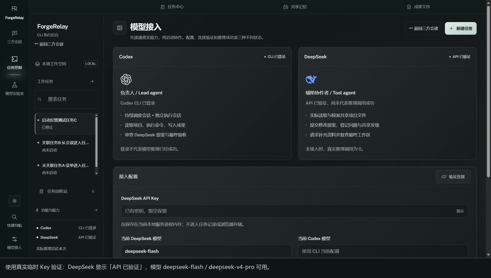
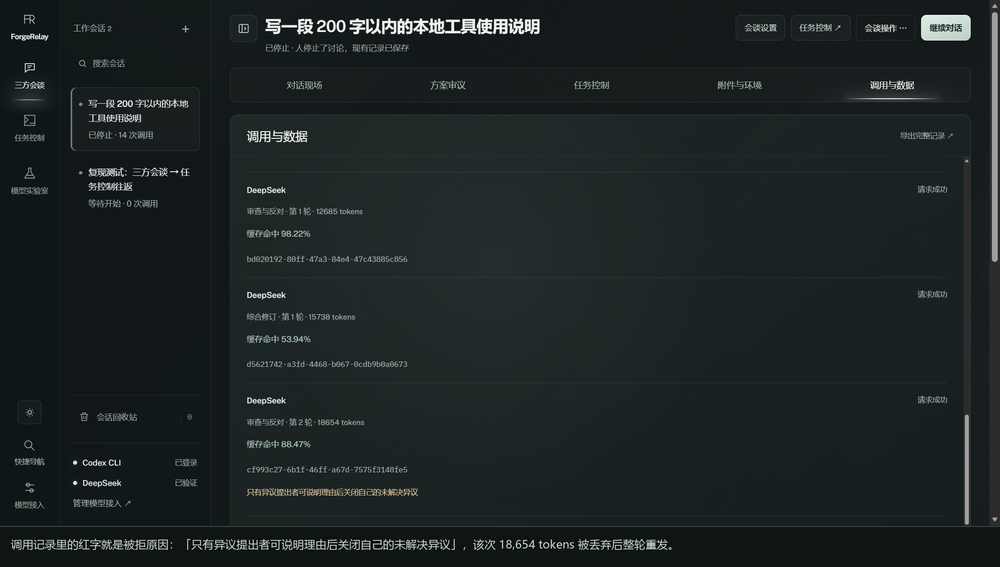
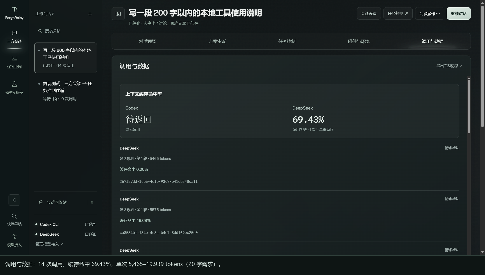

# ForgeRelay 0.6.1 · 后端（engine）问题报告

> 提交对象：ForgeRelay 作者
> 被测版本：`ForgeRelay-0.6.1-Windows-x64.exe`（便携版，engine `/api/health` 返回 `version: 0.6.1`）
> 运行环境：Windows 11（NT 10.0.26200）· Codex CLI `0.164.0-alpha.11.1`（ChatGPT 账号，`codex login status` 通过）· Clash for Windows 系统代理 `127.0.0.1:7890`
> 复现方式：解包 `resources/engine/*.mjs` 与 `resources/app.asar` 做源码审查；用**同一份 engine 代码**在独立数据目录（端口 `18999`）启动，直接调用真实 Codex CLI / 真实 DeepSeek API；解析层用真实 CLI 抓包序列回放验证。DeepSeek 侧使用你提供的临时 Key（只驻留进程内存，未写入任何文件、未进入本报告）。
> 标注规则：「已实测」= 我在本机跑出来的结果；「源码确认」= 代码路径明确但未触发真实付费调用；「需补充」= 需要你提供界面文案。

---

## 0. 摘要

| 编号 | 严重度 | 问题 | 状态 |
| --- | --- | --- | --- |
| B-1 | 🔴 严重 | Codex 适配器把 CLI 的**临时重试事件**当成致命失败：CLI 已经给出答案并 `exit 0`，引擎仍把这次调用标记为失败并丢弃结果 | 已实测（回放真实抓包） |
| B-2 | 🔴 严重 | Codex CLI 只读 `HTTPS_PROXY/ALL_PROXY`，不读 Windows 系统代理；"验证连接"只测 `codex login status`，测不出真实推理不通 | 已实测 |
| B-3 | 🔴 严重 | DeepSeek「输出被程序拒绝」：一个不存在的 `objectionIds`（O4）就让整轮 1.3 万 tokens 作废并整轮重发；连续 3 次即 `unresolved` | **已用真实 Key 复现** |
| B-4 | 🔴 严重 | token 成本放大：一次调度决策 1.8–2.2 万输入 tokens；**一次 20 字需求的讨论 14 次调用 / 154,980 tokens**；会谈默认预算 100 万 | 已实测 |
| B-5 | 🟠 中 | DeepSeek Key 只存进程内存（设计如此），桌面版每次启动都失效 | 已实测 |
| B-6 | 🟠 中 | 任务/会话作用域只在 UI 层过滤，接口返回全量数据 | 源码确认 |
| B-7 | 🟡 轻 | 引擎重启会把运行中任务改成 `interrupted`，但没有醒目的用户提示 | 源码确认 |

---

## B-1 🔴 Codex 适配器把"重试"误判为"失败"，成功结果被丢弃

### 现象

三方会谈 / 任务执行里 Codex 调用报错：

```
Reconnecting... 5/5 (request timed out)
Reconnecting... 3/5 (workspace routing discovery failed)
```

这两句话**不是 ForgeRelay 的文案**，是 `codex.exe` 自己在重试时输出的（我在 `codex.exe` 二进制里能搜到这两个字符串）。真实情况是：CLI 重试 5 次后**已经拿到了回答**，但 ForgeRelay 把这次调用判成失败。

### 证据 1：真实 Codex CLI 的一次成功调用（我这边的抓包，耗时 329 秒）

```
{"type":"thread.started","thread_id":"01a17878-..."}
{"type":"turn.started"}
{"type":"error","message":"Reconnecting... 2/5 (request timed out)"}
{"type":"error","message":"Reconnecting... 3/5 (request timed out)"}
{"type":"error","message":"Reconnecting... 4/5 (request timed out)"}
{"type":"error","message":"Reconnecting... 5/5 (request timed out)"}
{"type":"item.completed","item":{"id":"item_0","type":"error","message":"Falling back from WebSockets to HTTPS transport. request timed out"}}
{"type":"error","message":"Reconnecting... waiting for network (Connection failed: error sending request)"}
{"type":"item.completed","item":{"id":"item_1","type":"agent_message","text":"Hello! I’m here and ready."}}
{"type":"turn.completed","usage":{"input_tokens":17163,"cached_input_tokens":13312,"output_tokens":12,...}}
→ exit code 0，用时 329.4 秒
```

### 证据 2：把这段真实事件序列喂给**你现在的解析代码**

（脚本复用 `engine/adapters.mjs` 的 `createCodexAdapter`，只把子进程换成回放器，其他完全一样）

```js
// probe-codex-parsing.mjs（关键片段）
import { createCodexAdapter } from './src/engine/adapters.mjs';
const adapter = createCodexAdapter({ bin:'codex.exe', root, config, spawnProcess: () => new FakeChild(realEventStream) });
try { console.log(await adapter({ task, prompt:'…', signal, schema:null, readOnly:true, onEvent, onUsage, onTrace })); }
catch (e) { console.log('rejected:', e.message); }
```

实际输出：

```json
{
  "outcome": "rejected",
  "error": "Reconnecting... waiting for network (Connection failed: error sending request)",
  "events": [
    ["trace", "stub-thread-0001"],
    ["message", "Hello! I’m here and ready."],
    ["usage", "{\"input_tokens\":17163,\"output_tokens\":12,...}"]
  ]
}
```

**已经收到 `agent_message` 和 `turn.completed.usage`，仍然 reject。** 你的本地数据也印证了这一点：`discussions.json` 里两次 Codex 失败调用的 `error` 正好是上面那两句，其中一次 `tokens: 18829`（说明 `turn.completed` 已返回、已经计费）。

### 根因

```js
// adapters.mjs:95
if (event.type === 'error') failure = event.message || 'Codex 返回错误';
```

```js
// adapters.mjs:108-111
proc.on('close', code => {
  if (signal.aborted) return finish(new Error('任务已停止'));
  if (failure || code !== 0 || !last) return finish(new Error(failure || `Codex 没有正常返回结果（退出码 ${code}）。${stderr.slice(-1200)}`));
  finish(null, last);
});
```

`{"type":"error"}` 在 Codex CLI 里**既可能是重试中的瞬时错误，也可能是最终错误**；现在的实现把第一个 `error` 永久记住（`failure`），此后即便 `item.completed.agent_message` + `turn.completed` + `exit 0` 全部到齐，也照样失败。

### 修复建议

```js
let transient = '';                       // 只留痕，不判死刑
// ...
if (event.type === 'turn.failed') failure = event.error?.message || 'Codex 执行失败';
if (event.type === 'error') transient = event.message || transient;
// ...
proc.on('close', code => {
  if (signal.aborted) return finish(new Error('任务已停止'));
  if (failure || code !== 0 || !last) return finish(new Error(failure || `Codex 没有正常返回结果（退出码 ${code}）。${stderr.slice(-1200)}`));
  if (transient) onEvent('retry', `Codex CLI 曾重试：${transient}`);   // 前端可见，但不影响结果
  finish(null, last);
});
```

另外建议：

1. **无进展超时**：现在只有 15 分钟总超时（`adapters.mjs:79`）。加一条"连续 90 秒无任何 stdout 事件 → 主动 terminate，报『Codex 无响应，可能网络不通』"，比等 15 分钟友好。
2. 把 `{"type":"error"}` 写进事件流，让前端能显示"正在重试 3/5"（配合前端报告 F-3）。
3. 失败时保留已拿到的 `last` 文本（至少进日志），不要整段丢弃。

### 验收标准

回放上面的真实事件序列 → 适配器 **resolve**，返回 `"Hello! I’m here and ready."`，同时把重试信息作为 warning 事件抛出。

---

## B-2 🔴 Codex CLI 不走系统代理；"验证连接"测不到真实推理

### 现象

> 「GPT 调用失败。我已开 VPN」

实测结论：**不是账号/登录问题，是 Codex CLI 的网络路径没走 VPN**。

### 证据（本机实测）

| 测试 | 结果 |
| --- | --- |
| `curl https://chatgpt.com/`（无代理环境变量） | `000`，12.0 秒超时 |
| `curl https://api.openai.com/v1/models`（无代理） | `000`，12.0 秒超时 |
| `curl https://api.openai.com/v1/models`（`HTTPS_PROXY=http://127.0.0.1:7890`） | `401`，3.0 秒（可达，只是没带 key） |
| `codex exec "hello test"`（无代理） | **329 秒**，5 次 `Reconnecting... request timed out`，最后才成功 |
| `codex exec "check proxy path"`（带 `HTTPS_PROXY/HTTP_PROXY/ALL_PROXY`） | **77 秒**，0 次重连，直接成功 |

本机代理状态：

```
HKCU\...\Internet Settings : ProxyEnable=1  ProxyServer=127.0.0.1:7890   ← 浏览器/Electron 用这个
netsh winhttp show proxy   : Direct access (no proxy server)
```

也就是说，你开的 VPN 是**系统代理模式**（Clash 127.0.0.1:7890）：Chromium（Electron 界面）会用它；但引擎里的 Node `fetch`（DeepSeek 请求）和 `codex.exe` 都**不读 Windows 系统代理**——Node 默认不读，`codex.exe` 是 Rust/reqwest，只认 `HTTPS_PROXY`/`ALL_PROXY` 环境变量（`codex.exe` 二进制里能搜到这两个字符串）。

### 根因（代码）

```js
// main.cjs:49-51  spawn 引擎
engine=spawn(bundled,[path.join(engineRoot,'server.mjs')],{ … env:{...process.env, PORT:…, RELAY_DATA_DIR:…} });
// adapters.mjs:73   spawn codex
const env = { ...process.env }; delete env.DEEPSEEK_API_KEY;
```

两处都只是"继承现有环境变量"。用户机器上没有设置 `HTTPS_PROXY`（我在用户环境里查过，没有），所以 Codex CLI 全程直连 → 每次 5 分钟重试风暴 → 触发 B-1 的误判 → 用户看到"GPT 调用失败"。

更糟的是「验证连接」：

```js
// adapters.mjs:24
spawn(bin, ['login','status'], …)      // 只证明本地已登录
```

`login status` 是纯本地检查，**不发起网络请求**，所以永远"通过"，UI 显示「CLI 已登录」，实际推理根本不通。

### 修复建议

1. **真实前置探测**：把 `/api/check` 的 Codex 分支改成一次真实的 mini 推理（`codex exec --ephemeral --skip-git-repo-check --sandbox read-only - <<< "ping"`，超时 60 秒），结果分三态：`已登录 / 已登录但网络不通 / 未登录`。
2. **支持代理配置**：在「模型接入」加一个"Codex 代理"输入框（默认读系统代理），保存后注入 spawn env（`HTTPS_PROXY/HTTP_PROXY/ALL_PROXY`）；Windows 下可顺带读 `HKCU\...\Internet Settings\ProxyServer` 做默认值。
3. **文档**：明确写"系统代理模式的 VPN 不会作用于 Codex CLI，请设置 HTTPS_PROXY 或使用 TUN/全局模式"。
4. 失败文案统一：把 `Reconnecting...` 转成中文可操作提示（"Codex 连不上 OpenAI，请在设置里填写代理"）。

### 验收标准

- 无代理、网络不通时，「验证连接」必须失败并给出"网络不通"的明确原因，而不是显示"CLI 已登录"。
- 填入代理后，同一个探测在 60 秒内通过。

---

## B-3 🔴 DeepSeek「输出被程序拒绝」：已用真实 Key 复现

> 你写道「deepseek 一直在被系统拒绝输出」。这句在代码里对应的是 `discussion.mjs` 的协议校验拒绝，界面上会显示成系统消息：
> **「上次输出被程序拒绝：<原因>。请重新按规则输出，未修改任何异议或方案。」**

### 复现结果（真实 DeepSeek Key，已复现）

隔离环境（端口 18999、独立数据目录），团队设为 3 个 DeepSeek 角色（lead / research / critic，`minRounds=1`、`maxRounds=2`），需求只有 20 个字：**「写一段 200 字以内的本地工具使用说明」**。

`POST /api/check` → `API 已验证，尚未代表推理调用成功`；`/models` 返回 `deepseek-flash`（DeepSeek-V4.1-Flash）与 `deepseek-v4-pro`。



**4 分钟内：14 次调用 / 154,980 tokens，其中 3 次被程序拒绝、合计 44,996 tokens 被丢弃后整轮重发。**

| # | 阶段 | tokens | 结果 |
| --- | --- | --- | --- |
| 1–3 | 确认规则 | 5,465 / 5,575 / 5,702 | ✅ |
| 4 | 提交方案 | 7,082 | ✅ |
| 5–6 | 审查与反对 | 8,910 / 10,160 | ✅ |
| 7 | 审查与反对 | 13,400 | ❌ `最多给人三个有效选择，引用的异议必须存在` |
| 8 | 审查与反对 | 12,942 | ❌ 同上 |
| 9 | 审查与反对 | 12,685 | ✅ |
| 10 | 综合修订 | 15,738 | ✅ |
| 11 | 审查与反对 | 18,654 | ❌ `只有异议提出者可说明理由后关闭自己的未解决异议` |
| 12–13 | 审查与反对 | 18,728 / 19,939 | ✅ |
| 14 | 审查与反对 | 0 | 手动停止 |

引擎里存的原文（`GET /api/discussions/<id>` 的 `messages` 与 `calls[].validationError` 可核对）：

```text
[System/validation] 上次输出被程序拒绝：最多给人三个有效选择，引用的异议必须存在。请重新按规则输出，未修改任何异议或方案。
[System/validation] 上次输出被程序拒绝：只有异议提出者可说明理由后关闭自己的未解决异议。请重新按规则输出，未修改任何异议或方案。
```

截图：`evidence/10-调用记录-被程序拒绝的调用.png`（调用记录里的红字）、`evidence/09-调用与数据-14次调用与缓存命中.png`（14 次调用、缓存命中 69.43%）。



### 真正的原因：不是 JSON 格式，而是两条语义规则

引擎把被拒原文存在 `calls[].rejectedOutput` 里，可以逐字段核对。

**第 7、8 次（`最多给人三个有效选择，引用的异议必须存在`）**

```json
{"kind":"gap","topic":"安全边界缺少权限提升提示",
 "options":["补半句…","用搬移附注…","不补…"],
 "objectionIds":["O4"]}
```

当时房间里只有 `O1 / O2 / O3` 三条异议，模型引用了不存在的 `O4`（它在 detail 里写"新增 O4"，但 `signals.objectionIds` 只能引用**已存在**的异议）。校验代码：

```js
// human-loop.mjs:49
if(s.options.length>3 || s.options.some(o=>!text(o,200)) ||
   s.objectionIds.some(id=>!r.objections.some(o=>o.id===id)))
  throw Error('最多给人三个有效选择，引用的异议必须存在');
```

两个完全不同的错误被塞进同一句文案，而且**一个不存在的 ID 就让整轮 13k tokens 的分析作废**。实测两次都是 `options` 合法（正好 3 个）、只有 `O4` 这一个 ID 越界。

**第 11 次（`只有异议提出者可说明理由后关闭自己的未解决异议`）**

```json
{"close":{"objectionId":"O3","reason":"作为提出者确认：v2 第2段已改为条件式…"}}
```

`O3` 是另一个角色登记的，这一回合的角色不是提出者（`discussion.mjs:54`）。三个角色跑的是同一个模型，模型把自己的"角色身份"判断错了，于是整轮 18,654 tokens 作废。

**结论：JSON schema、`rulesHash`、`revision`、`proposalHash` 全部能通过（11/14 次成功），真正卡住的是这两条语义规则 + 一次 ID 越界。** 我最初只看源码时把原因归到"哈希回抄"，实测证伪了这一点——这对修复方向影响很大，见下面的建议。

### 机制（源码确认）

```js
// discussion.mjs:288-305
const turn = validateTurn(room, actor, phase, JSON.parse(raw), snapshot, agent);   // 15 条硬性校验
…
} catch(err) {
  responseCall.validationError = err.message;
  responseCall.rejectedOutput  = raw.slice(0,16000);             // 被拒的原文（最多 16k 字符）
  room.feedback = `上次输出被程序拒绝：${err.message}。…`;
  this.note(room,'System','validation',room.feedback);
  room.formatErrors++;
  if (room.formatErrors >= 3) { room.status='unresolved'; room.reason='连续三次输出未通过协议校验，等待人处理'; }
}
```

关键点：**被拒之后不是"只修格式"，而是把同一个角色、同一份完整快照整轮重发一次**，直到 3 次用完 → 会话变 `unresolved`。被拒的那次调用已经真实发生并计费（`call.usage` 照记）。

### 最容易踩中的规则（`discussion.mjs:37-59`）

> 实测补充：下面这些 **schema / 哈希类**规则 11/14 次都能通过；真正触发拒绝的是上面那两条**语义规则**（`human-loop.mjs:49` 的 `objectionIds` 必须存在、`discussion.mjs:54` 的"只有提出者能关闭"）。所以修复重点不是"放宽 JSON"，而是"不要让一个越界 ID 作废整轮回复"。

| 规则 | 代码 | 说明 |
| --- | --- | --- |
| 必须逐字回抄 `rulesHash`（12KB 规则的 sha256） | `:40` | 模型只能"抄"，抄错一位就整轮被拒 |
| `revision` / `proposalHash` 必须精确匹配 | `:42` | 同上，模型需要从快照复制 64 位 hex 与整数版本号 |
| schema 不允许任何多余字段 | `:31-36`（`Object.keys(v).every(k=>schema.properties[k])`） | 模型加一个 `"notes"` 就立刻被拒 |
| `ground` 阶段所有数组必须为空、`stance=undecided` | `:44` | |
| `challenge`/`synthesis` 必须有 `analysis` | `:45` | |
| `vote` 阶段不能带 `proposal/close/replies` | `:47` | |
| `agree` 的 summary ≥ 15 字且不能再提问题 | `:57` | |

聊天模式还有两个"精确键 + 强制讨论理由"的硬校验：

```js
// conversation.mjs:109
if (!answer || Object.keys(answer).sort().join(',') !== 'complexity,discussionQuestion,discussionReason,reply' || …)
  throw Error('lead 对话输出格式无效');
// conversation.mjs:110-111
if (ask && (!answer.discussionQuestion.trim() || !answer.discussionReason.trim()))
  throw Error('复杂任务必须由 lead 说明讨论理由并询问用户');
```

任何一个不符 → 这次调用直接失败（不是拒绝式重试，是抛错）。

### 为什么这会烧掉大量 token

每次拒绝 = 一次完整调用（system prompt 里带 3 份规则 md + discussion schema JSON + 完整快照），然后下一轮**再发一遍**。如果模型稳定地在同一个点上犯错（比如哈希抄错），就会"一直发、一直被拒"，3 次后变 `unresolved`，用户看到的是"DeepSeek 一直不输出，还烧了一堆 token"。

### 仍未解释的部分

你的数据目录里没有 DeepSeek 调用记录（唯一房间的 3 次调用全是 Codex），所以复现不到"和你当时完全同一条"。但从上面的实测可以确定：**只要模型在 `signals.objectionIds` 里写了一个不存在的 ID，或者在 `close` 里关别人登记的异议，就会看到"输出被程序拒绝"**——两种都不需要模型"格式错"，也都不该让整轮作废。

按下面第 1、2 条修复后，这类拒绝会立刻消失；如果修完还出现，请把 `调用记录` 里的 `validationError` 原文发我。

### 修复建议（针对实测原因，按性价比排序）

1. **未知 `objectionIds` 直接过滤，不要拒绝整轮**（`human-loop.mjs:49`）：

   ```js
   for (const s of turn.signals) {
     s.objectionIds = (s.objectionIds || []).filter(id => r.objections.some(o => o.id === id)); // 丢掉不存在的
     if (s.objectionIdsDropped) logWarning(...)
   }
   ```
2. **拆开报错文案**：现在是 `最多给人三个有效选择，引用的异议必须存在`（两个条件合一）。应分别报 `options 超过 3 个（当前 4 个）` / `引用了不存在的异议 O4（当前只有 O1–O3）`，作者和用户才可能自查。
3. **`close` 非提出者时降级为 `replies`**（`discussion.mjs:54`）：记一条"该角色认为 O3 的解决条件已满足"，由真正提出者确认，不要把整轮 18k tokens 丢掉。
4. **不要要求模型回抄哈希/版本号**。调用发起时引擎已经记录了这些值：

   ```js
   // discussion.mjs:209
   const call = { … revision: room.revision, proposalHash: room.proposal?.hash || '' … };
   ```

   实测这些字段能通过，但它们是纯机械信息，让服务端绑 `call.revision` / `call.proposalHash` 更稳，也能缩短 prompt。
5. **便宜的修复回路**：被拒后先发一个**只带 schema + 上次输出 + 错误原因**的小请求（几 KB），成功后继续原流程；仍失败再降级为整轮重发。
6. **UI 展示**：把 `validationError` + `rejectedOutput` 摘要 + "本次已消耗 N tokens" 一起显示，并提供「按当前输出重试一次」按钮（重置 `formatErrors`）。
7. **宽容解析**：未知字段丢弃；`analysis/objections/replies/close/signals` 缺省 `[]`；`stance` 做 `trim().toLowerCase()`。
8. **3 次后不要静默 unresolved**：给出"原因列表 + 一键放宽严格度/改写输入"的出口。

---

## B-4 🔴 token 成本放大：一次调度决策 1.8–2.2 万 tokens；一次 20 字讨论 15.5 万 tokens

### 实测数据 1（隔离环境、真实 Codex、只跑调度决策）

| 第几次调用 | 目的 | 输入 tokens | 输出 tokens | 状态 |
| --- | --- | --- | --- | --- |
| 1 | `direct`（首轮决策） | 18,442 | 150 | 成功，但被引擎 gate 拒绝（"首个动作必须制定任务计划"） |
| 2 | `direct` | 20,598 | 346 | 成功（给出任务计划） |
| 3 | `direct` | 21,524 | 192 | 成功（给出 delegate 指令） |
| 合计 | — | **60,564** | **688** | 产出：一个任务计划 + 一句决策，**没有任何文件/代码** |

你本地数据里的同构证据：

- `tasks.json` 中一次**失败**的 Codex 调用：`input_tokens: 18649, output_tokens: 602, cached_input_tokens: 0`；
- `discussions.json` 中一次失败调用：`tokens: 18829`；
- 现有数据合计已记录 **56,447 tokens**（tasks 37,618 + 会谈 18,829）。

### 实测数据 2（真实 DeepSeek 讨论，需求只有 20 个字）

| 指标 | 实测值 |
| --- | --- |
| 需求 | 「写一段 200 字以内的本地工具使用说明」（20 字） |
| 调用次数 | **14 次**（3 角色 × 确认规则 / 提案 / 多轮审查 / 综合） |
| 总 tokens | **154,980** |
| 耗时 | 约 4 分钟 |
| 单次 tokens | 5,465 → 5,575 → 5,702 → 7,082 → 8,910 → 10,160 → 13,400 → 12,942 → 12,685 → 15,738 → 18,654 → 18,728 → 19,939（随 transcript 单调增长） |
| 被拒作废 | 3 次，合计 **44,996 tokens** 被丢弃后又整轮重发 |
| 缓存命中率 | 69.43%（个别调用 98.22%，第一次 0%） |

也就是说：**一句 20 字的需求，4 分钟烧掉 15.5 万 tokens**。



### 成本结构（为什么这么贵）

1. **每次调用都重发规则与 schema**：`core.mjs:281-287` 把整段 director 规则 + `director.schema.json` 拼进 prompt；`discussion.mjs:17,26-27` 把 3 份规则 md（`DISCUSSION_RULES.md` + `RUNTIME_RULES.md` + `HUMAN_LOOP_RULES.md`）拼进 system。
2. **Codex CLI 自己的固定开销**：我实测一个"hello"，CLI 自己就要 17,163 输入 tokens（带代理那次甚至 68,017，其中 60,544 cached）。它会把内置 system prompt、工具、技能都带上。
3. **任何 gate/格式拒绝都整轮重发**：实测第 1 次调用（150 输出 tokens）被"首个动作必须制定任务计划"拒绝后，第 2 次又花了 20,598 tokens（`core.mjs:289-293`）。B-3 的拒绝同理。
4. **默认预算自相矛盾（任务）与过大（会谈）**：

   ```js
   // core.mjs:77   任务默认
   maxSteps: 24, maxCalls: 48, tokenBudget: 100000
   // discussion.mjs:125  会谈默认
   tokenBudget: 1_000_000
   ```

   任务按实测 2 万 tokens/次，100k 预算在第 **5** 次调用就撞墙，`maxCalls: 48` 根本用不到；而会谈默认给 **100 万** tokens，按实测 15.5 万/次小讨论，**一次会谈就能烧掉 30 万以上**——这正是"29w"的量级。

### 关于你提到的「一堆屁话花了 29w token」

现在有实测了：**一次 20 字需求的小讨论 = 154,980 tokens**，29 万 ≈ **两次这样的讨论**（或一次 3 角色、2 轮的完整讨论）。不需要"Codex 疯狂重试"也能达到这个量级。

- 现有 `%APPDATA%\ForgeRelay\data` 里只核到 **56,447** tokens（旧会话，DeepSeek 部分没有记录）；
- DeepSeek 平台用量页如果显示 29w，和实测完全对得上：单次 5.5k–19.9k、14 次调用、再加被拒后整轮重发；
- 你感觉"一堆屁话"也和实测一致：每个角色都要输出一段"确认规则/审查/综合"，文本长度几十到几百字，但每轮都要把整份上下文（规则 + schema + transcript）重新发一遍。

### 修复建议

1. **规则只注入一次**：把规则/schema 移到 `AGENTS.md` 或 `-c` 配置/文件引用，不再每轮内联（Codex 侧还能吃到 prompt cache）。
2. **调度决策用小上下文**：决策只需要"当前状态摘要 + 期望 JSON"，不要每轮重发完整需求/证据；证据走工具按需读取。
3. **gate 拒绝只回传违规原因**（现在 `rejection` 已经这么做了，但整轮 system + 快照仍在重发，建议压缩）。
4. **任务默认预算按实测重算**：例如 `tokenBudget: 400000`，或默认 `maxCalls: 10` 并把"单次 ≈2 万 tokens"写进弹窗提示。
5. **会谈默认预算降到实测量级**：现在默认 1,000,000；建议默认 200,000，并在「会谈设置」里显示"预计 N 次调用 / ≈M tokens"。
6. **减少重复发言**：`ground` 阶段三个角色各说一遍"确认规则"就花掉 16,742 tokens（5,465+5,575+5,702）。建议 ground 合并为一次确认，或者用 1 行结构化回执。
7. **UI 预判成本**：每次调用前显示"预计消耗 ≈N tokens / 剩余预算"，并在预算 < 2 次调用时警告；被拒的那一轮也要显示"已花费 N tokens"。

### 验收标准

- 一次"plan + 1 次 delegate"的任务，总输入 tokens 应显著低于当前的 60k（目标：< 25k），且规则文本只出现一次。
- 同一句 20 字需求的三方会谈：总 tokens 应从 15.5 万降到 5 万以内（ground 合并 + 拒绝不重发 + 上下文裁剪）。

---

## B-5 🟠 DeepSeek Key 只存进程内存（设计如此，桌面版体验是 Bug 级）

### 证据（已实测）

```text
POST /api/config {deepseekKey:"sk-…"}  →  {saved:true, deepseekConfigured:true}
重启引擎（桌面版每次启动都会重启引擎）
GET /api/state                        →  deepseekConfigured:false, message:"未配置 API Key"
在数据目录全文搜索该 key               →  0 命中（确认不落盘）
```

### 代码

```js
// server.mjs:21
const config = { deepseekKey: process.env.DEEPSEEK_API_KEY || '', … };
// server.mjs:104-113  /api/config 只改内存变量
// server.mjs:97       反而禁止把 key 写进模型配置
// model-settings.mjs:87  “Credentials and arbitrary provider URLs are never persisted.”
```

`README.md:17 / README.md:120`、`DESIGN.md:21` 也明确写着"密钥仅驻留服务内存，重启后需重新输入"。

**判定：设计如此，不是 Bug**；但桌面版把"引擎进程"和"应用生命周期"绑死（`main.cjs:49`），等于"每次打开应用都要重填"。

### 修复建议

- 主进程用 `safeStorage.encryptString()`（Windows DPAPI）落盘加密密钥，按需解密后通过 env 注入引擎；
- 或提供 `DEEPSEEK_API_KEY` 环境变量 / `ForgeRelay.config.json` 支持（引擎已读 env，桌面端没暴露）；
- 至少给一个"记住本机"勾选项 + 启动横幅提示。

---

## B-6 🟠 作用域只在 UI 层：接口返回全量任务

```js
// server.mjs:87
if (url.pathname === '/api/state') return json(res,200,{ token,
  tasks: publicTasks(workbench.tasks),          // 全量，含所有会话的任务
  config: { … } });
// server.mjs:86  /api/navigation 同样是全量
```

前端 `app.js:38` 再按 `?room=` 过滤。这导致：

- 任何视图切换都可能"丢任务"（前端报告 F-1/F-2）；
- 第三方/CLI 调用方也拿不到"这个会话有哪些任务"的直接答案，只能自己按 `sourceDiscussion.id` 过滤。

建议：`/api/state` 与 `/api/navigation` 增加 `rooms` 与每个任务的 `roomId` 字段，并提供 `GET /api/tasks?room=<id>`；前端只做展示，不做隐式过滤。

---

## B-7 🟡 引擎重启把运行中任务改成 interrupted，但用户看不到

```js
// core.mjs:59-63
this.tasks.forEach(t => {
  …
  if (ACTIVE.includes(t.status)) { t.status = 'interrupted'; t.error = '服务已重启；历史与文件已保留，可重新运行。'; }
});
```

桌面版每次启动/重连都会 spawn 新引擎（`main.cjs:49`），所以"关掉应用再打开"会把跑着的任务全部改成中断。这本身是合理保护，但：

- 没有 toast/inbox 提示"N 个任务被中断"；
- 前端只有 `interrupted` 状态文案（`app.js:29`），没有"复制为新任务继续"的直达入口。

建议：启动后若有被中断任务，弹一次汇总提示 + 每个任务卡片给「复制为新任务」。

---

## 关于你最初 4 条问题的判定汇总

| 你的描述 | 判定 | 对应 |
| --- | --- | --- |
| 1. 接入 DeepSeek 并验证后，重启仍要重新输入 | **不是 Bug，是设计**（密钥只在内存） | B-5 / F-5 |
| 2. 三方会谈时 GPT 调用失败（已开 VPN） | **确认有 Bug**：适配器误判重试 + CLI 未走代理 + 验证连接测不出真实推理 | B-1 / B-2 |
| 3. 任务控制 ↔ 三方会谈往返后任务消失，但仍显示进行中 | **确认有 Bug**：任务列表被 `?room=` 静默过滤，运行中任务在所有会谈视图不可见 | F-1 / F-2 |
| 4. 启动任务仍无反馈 | **确认有 Bug**（体验层）：长调用期间没有任何进度/重试提示；根因是 B-1/B-2 让调用一直重试到失败 | F-3 / B-1 / B-2 |

新增两条：

| 你的描述 | 判定 | 对应 |
| --- | --- | --- |
| DeepSeek 一直被系统拒绝输出 | **已用真实 Key 复现**：3/14 次被拒，原因是 `signals.objectionIds` 引用了不存在的 `O4`（整轮 13k tokens 作废）和"关闭别人登记的异议"；界面文案就是「上次输出被程序拒绝：…」 | B-3 |
| 一堆废话花了 29w token | **已实测**：一次 20 字需求的讨论 = 14 次调用 / **154,980 tokens**（4 分钟）；被拒的 3 次又白烧 44,996 tokens；会谈默认预算 100 万 | B-4 |

---

## 附：修复优先级建议

1. **B-1**（几分钟就能改，收益最大）：不再把瞬时 `error` 当致命失败 + 无进展超时。
2. **B-2**（体验致命）：真实网络探测 + 代理配置注入。
3. **B-3**（用户最直接的"DeepSeek 被拒绝"）：未知 `objectionIds` 过滤掉而不是整轮拒绝；`close` 非提出者降级为回应；拆开报错文案。
4. **B-4**（花钱的地方）：ground 合并、规则只注入一次、拒绝不整轮重发、会谈默认预算降到 20 万。
5. **F-1 / F-2**（数据"消失"的根因）：作用域显式化 + 运行中任务常驻指示。
6. **F-3**（反馈）：把 call/retry 事件写进执行现场。
7. **B-5 / B-6 / B-7**（打磨）。
